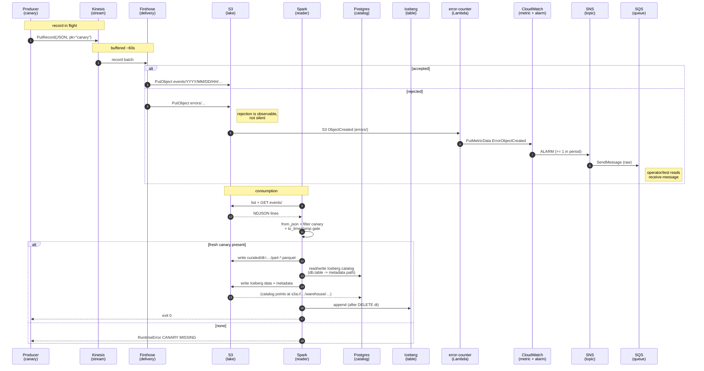

# Sample project on using Kinesis with Spark

Демонстрация прогона данных от Kinesis к Spark.

## Ключевые решения

### Canary-гейт

Перед публикацией Spark ищет событие `event_type = "canary"` с `emitted_at`
не старше `CANARY_LOOKBACK_MINUTES` (по умолчанию 10 мин). Нет — RuntimeError,
ничего не пишется. Защита от «тихого» устаревания данных: лучше не опубликовать,
чем опубликовать устаревшее.

### Идемпотентность silver-слоя

Firehose даёт at-least-once, джоба может ретраиться. Поэтому:

- дедупликация по бизнес-ключу `(partition_key, emitted_at)` перед записью;
- вставляем только новое, существующее не трогаем, файлы не перезаписываем;
- перезапуск джобы не меняет состояние silver'а.

### Наблюдаемость отказов

Неудачные записи Firehose не теряются молча: `errors/` - Lambda - метрика 
alarm - SNS - SQS. Отказ доставки виден оператору.

### Parquet как экспорт, а не второй источник правды

Parquet-слой пересобирается из Iceberg по затронутым dt. Это гарантирует,
что Iceberg и Parquet не разъезжаются: Parquet - снимок silver'а на момент
экспорта. Перезапуск джобы даёт тот же результат.

| Компонент | Роль |
|---|---|
| **Kinesis** | буфер входящих записей |
| **Firehose** | батчит ~60 с, пишет в `events/` или `errors/` |
| **Lambda `canary`** | EventBridge шлёт «живое» событие — маркер работоспособности |
| **Lambda `error-counter`** | реагирует на `S3 ObjectCreated` в `errors/`, публикует метрику |
| **CloudWatch, SNS, SQS** | алерт об отказах доходит до оператора |
| **Spark job** | читает `events/`, проверяет canary, пишет в Iceberg + Parquet |
| **Postgres** | JDBC-каталог Iceberg |
| **SSM / STS / KMS / IAM** | конфигурация, assume-role, шифрование, права |